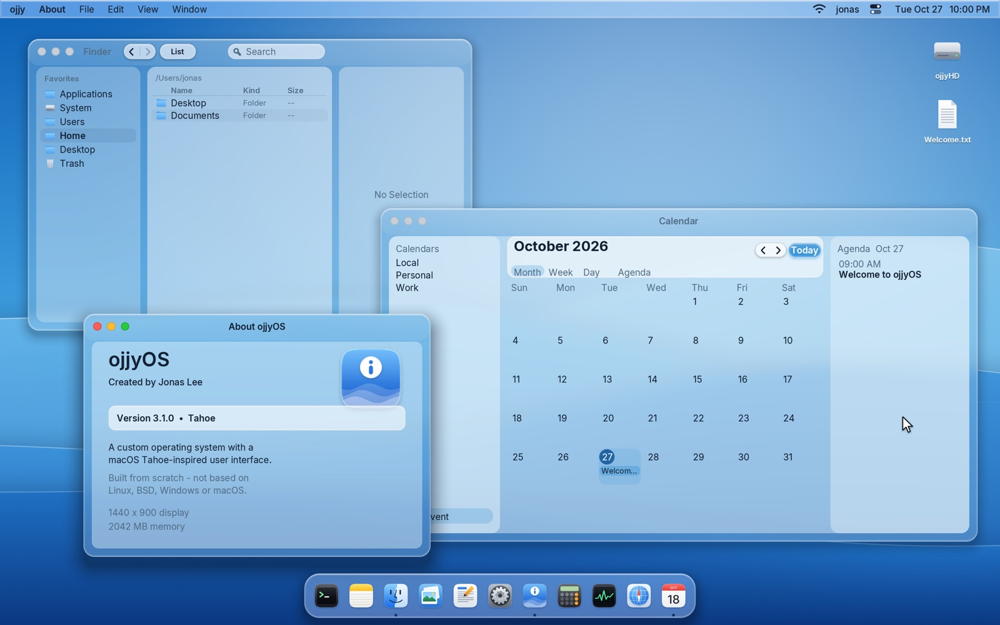
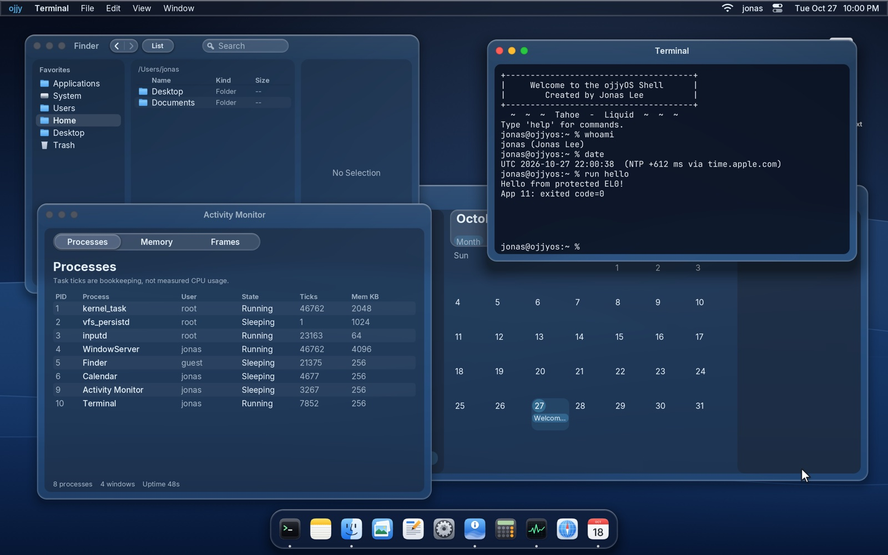
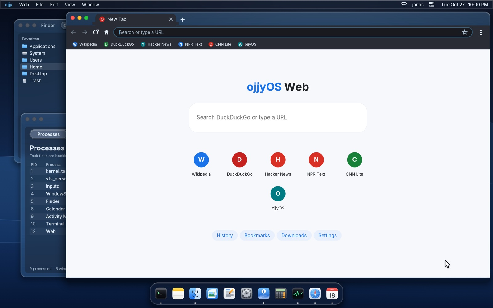
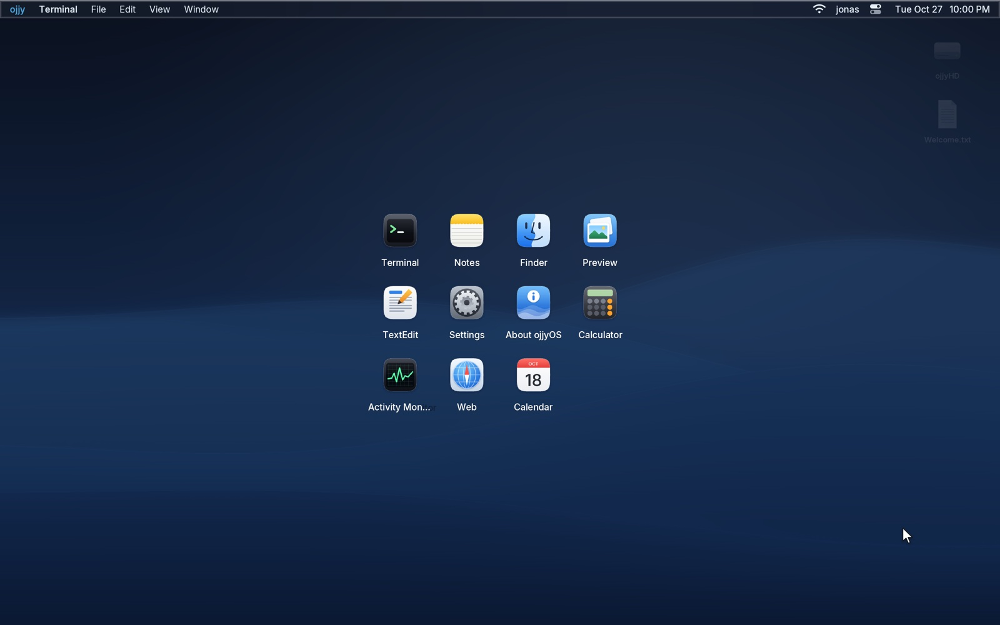

<div align="center">

# ojjyOS

**A 64-bit operating system written from scratch, with a blue Liquid Glass desktop inspired by macOS Tahoe.**

Its own kernel, UEFI bootloader, drivers, filesystems, network stack and web engine. Not based on Linux, BSD, Windows or macOS.

**Created by Jonas Lee** ([`ojjy`](https://github.com/jo-jo-home))

    

<br>



</div>

<br>

## Highlights

<table>
<tr>
<td width="33%" valign="top">

### 🧠 Original kernel
Dual-architecture kernel for **ARM64** (Apple Silicon) and **x86_64**, booted by its own UEFI loader. It includes a memory manager, kernel heap, interrupt handling and protected ARM64 programs running at EL0.

</td>
<td width="33%" valign="top">

### 🪟 Liquid Glass desktop
Translucent blue glass, light/dark/auto modes, Retina rendering with the Inter font, Dock, menu bar, Spotlight, Launchpad, Control Center, Mission Control and **11 built-in apps**.

</td>
<td width="33%" valign="top">

### 🌐 Online from scratch
Its own TCP/IP stack with DHCP, DNS and TCP, plus HTTP/1.1, a TLS 1.3 client, SNTP clock sync and **ojjyOS Web**, a tabbed browser with its own HTML/CSS layout engine.

</td>
</tr>
</table>

## Screenshots

<table>
<tr>
<td width="50%"></td>
<td width="50%"></td>
</tr>
<tr>
<td align="center"><sub>Dark mode: Terminal, Activity Monitor and Finder</sub></td>
<td align="center"><sub>ojjyOS Web, the built-in browser</sub></td>
</tr>
<tr>
<td width="50%"></td>
<td width="50%" valign="middle">

**Everything you see is drawn by ojjyOS itself:** the window manager, glass material, fonts, icons, animations and every app run on the custom kernel. The host Mac or PC only provides the virtual machine.

The screenshots use the built-in **ojjyOS Waves** wallpaper.

</td>
</tr>
<tr>
<td align="center"><sub>Launchpad</sub></td>
<td></td>
</tr>
</table>

---

## Contents

- [Features](#features)
- [What it can't do yet](#what-it-cant-do-yet)
- [Quick start](#quick-start)
- [Testing](#testing)
- [Keyboard shortcuts and commands](#keyboard-shortcuts-and-commands)
- [Project layout](#project-layout)
- [Roadmap and docs](#roadmap-and-docs)
- [Credits and license](#credits-and-license)

---

## Features

### Kernel and boot

- **Own UEFI bootloader** (`boot/ojjy-boot.c`), `BOOTAA64.EFI` and `BOOTX64.EFI`: parses the ELF64 kernel, loads its segments, passes the memory map and framebuffer, then jumps in.
- **ARM64:** EL2 → EL1 entry, kernel-owned page tables, GICv2/GICv3, architectural timer, PSCI power control and exception diagnostics.
- **x86_64:** long mode, GDT/TSS, IDT with a visual panic screen, 4-level paging, 8259 PIC + 1 kHz PIT, ACPI S5 power-off.
- **Memory:** map-sized physical page allocator with LOW/HIGH zones and privileged RAM-only mappings on ARM64 and x86_64, plus a coalescing kernel heap with corruption and double-free detection. Protected ARM64 programs and selected browser/TLS buffers can use RAM above 4 GiB; About and Activity Monitor show measured RAM.
- **Protected programs (ARM64):** separate static ELF programs run at EL0 with private memory, checked system calls, crash recovery and a 100 ms watchdog. Try `run hello` in Terminal. See [PROTECTED_APPS.md](PROTECTED_APPS.md).
- **Randomness:** ChaCha20 DRBG seeded from virtio-rng and timers.

### Drivers

| Apple Silicon (native app or QEMU) | Intel / AMD (QEMU or VirtualBox) |
|---|---|
| PCI and virtio-MMIO transports | UEFI GOP framebuffer |
| virtio GPU (2D, Retina), block, network, console, RNG | PS/2 keyboard and scroll mouse |
| virtio keyboard / tablet / wheel | ATA PIO (LBA28/48) + LRU block cache |
| xHCI USB keyboard and pointer | CMOS real-time clock |
| PL011 serial, PL031 RTC (QEMU) | 16550 serial, ACPI power-off, 8042 reset |

### Storage and accounts

- **Filesystems:** a VFS with **OJFS** (the read-only system image: apps, icons, web pages, programs) and **RAMFS** for `/Users` and `/Library`.
- **Saved to disk:** both RAMFS trees are checkpointed into two CRC-32-protected slots on the data partition. Saves happen automatically, on `sync` and on shutdown, and boot falls back to the older slot if the newest one is damaged.
- **Safe rebuilds:** rebuilding the disk image keeps your accounts and files and backs up the old disk first. Disks that are locked or unrecognised are refused, never reformatted.
- **User accounts:** first-boot Setup Assistant, lock screen, multiple users, **PBKDF2-HMAC-SHA256** password hashes with random salts, and admin-only account creation. Non-admin users can't open other users' home folders.

### Desktop

- **Liquid Glass** windows, Dock, menus and menu bar, with light, dark and auto (by time of day) appearance, 8 accent colours, clear or tinted glass, and Reduce Transparency / Reduce Motion.
- **Sharp on Retina screens:** renders at 2× of a 1440×900 desktop, using **Inter** for the interface and **JetBrains Mono** in Terminal, with anti-aliased shapes, shadows and smooth window/menu/Dock animations.
- **Desktop features:** menu bar dropdowns, Dock with magnification, Spotlight (`Cmd+Space`), Launchpad, Control Center, Mission Control, App Switcher, desktop icons and a right-click menu.

### Built-in apps

| App | What it does |
|---|---|
| **Finder** | Sidebar, list/icon views, search, rename, copy/cut/paste, drag-to-move, Trash, preview pane |
| **Terminal** | Shell with file, account, network (`ifconfig`, `ping`, `nslookup`, `curl`), clock and process commands |
| **TextEdit** | Word wrap, selection, clipboard, word and character counts |
| **Notes** | Notes sidebar, New Note (`Cmd+N`), autosave |
| **Calendar** | Month view, Today, events and agenda |
| **Calculator** | Mouse and keyboard input, equation history |
| **Activity Monitor** | Processes, Memory and Frames tabs |
| **Preview** | Picture viewer |
| **Settings** | Appearance, Users & Accounts, Wallpaper, Dock & Menu Bar, Network and more |
| **Web** | ojjyOS Web: tabs, address bar, bookmarks, history, downloads, find, zoom |
| **About** | Version and credits |

### Networking and the web

- **Network stack written from scratch:** Ethernet, ARP, IPv4, ICMP, UDP, DHCP, DNS and TCP.
- **HTTP/1.1** with chunked transfer, gzip/deflate, cookies, redirects and POST.
- **TLS 1.3 client** (x25519, ChaCha20-Poly1305, AES-GCM) on top of its own crypto: SHA-2, big-integer RSA and ECDSA P-256/P-384.
- **HTTPS that checks who you're talking to:** its own X.509 parser checks the certificate chain against 51 built-in root authorities, plus the host name and dates, and verifies the server's handshake signature. Bad certificates get a "This connection is not private" page; the address bar shows a lock only when the check passed.
- **Network time:** the clock syncs from `time.apple.com` (fallback `pool.ntp.org`) after DHCP and resyncs every 6 hours.
- **ojjyOS Web engine:** HTML parser, CSS cascade (with `@layer`, `var()` and media queries), and block/inline/flex/grid/table/float layout. It decodes PNG, GIF, JPEG, WebP and SVG images.

## What it can't do yet

ojjyOS is a long-term project, and these are the honest gaps today:

- **No multitasking yet.** Desktop apps run inside the kernel, there is no preemptive scheduler, and only one CPU core is used.
- **No real on-disk filesystem yet.** Files live in RAM and are saved to disk as checkpoints.
- **HTTPS is checked, but not completely:** revoked certificates are not detected yet, so don't use the browser for anything sensitive. TLS 1.2-only sites and JavaScript are not supported either.
- **Virtual machines only:** it runs under Apple's Virtualization.framework, QEMU or VirtualBox, not directly on Mac or PC hardware.
- **Memory:** legacy and device/DMA allocations still require RAM below 4 GiB; high RAM is opt-in for protected ARM64 programs and audited CPU-only browser/TLS buffers. Firmware and kernel reservations reduce managed capacity. The native launch menu currently offers up to 8 GB (within half of host RAM).
- No sound, and no Wi-Fi or Bluetooth hardware (virtual machines don't provide it).

Known bugs are tracked in [bugs/OPEN.md](bugs/OPEN.md).

---

## Quick start

### Apple Silicon Mac: native app (recommended)

Requires Apple Silicon, macOS 13 or later, the Command Line Tools and `lld` (`brew install lld`). No Xcode project or Linux VM is needed.

```bash
git clone https://github.com/jo-jo-home/ojjyOS-v3.git
cd ojjyOS-v3

ARCH=aarch64 bash scripts/build.sh   # kernel, bootloader and disk image
bash scripts/build-vmapp.sh          # ojjyOS.app (Apple Virtualization.framework)
bash scripts/run-vm.sh               # or double-click build/ojjyOS.app
```

On first boot the Setup Assistant creates your account.

<details>
<summary><b>Launch menu, saved data and developer options</b></summary>

<br>

The launch menu lets you choose 2/3/4/6/8 GB of RAM (within the VM's limits and half your Mac's RAM), a Retina screen size (1440×900, 1280×800 or 1600×900), network on/off and full-screen startup. The defaults are 2 GB, 1440×900, network on and windowed.

- **Start** (Return) saves the settings and boots. **VM → Launch Settings…** (`Cmd+,`) reopens the menu. Hold **Option** while opening the app to get the menu back if you turned it off.
- Settings live in `build/launch-settings.json` and survive rebuilds.
- Your disk is `build/aarch64/ojjyos3.img`, and logs go to `build/aarch64/serial-vz.log`.
- **Shut down inside ojjyOS, then quit the app before rebuilding.** Disks in use are locked and never overwritten.

For development, use a private disk with separate variables and logs:

```bash
bash scripts/run-vm.sh --image /absolute/path/test-disk.img \
  --vars /absolute/path/test-vars.fd --serial /absolute/path/test-serial.log \
  --start --memory 3072 --screen 1280x800
```

</details>

### macOS with QEMU

```bash
brew install qemu nasm lld
ARCH=aarch64 bash scripts/build.sh
bash scripts/run-qemu.sh aarch64     # Apple Silicon: hardware virtualization (HVF)
```

<details>
<summary><b>QEMU options</b></summary>

<br>

- `OJJY_ACCEL=tcg` uses software emulation instead of HVF.
- `OJJY_RES=3200x1800` fits a 16:9 monitor; `OJJY_FULLSCREEN=1` starts in full screen.
- `OJJY_DISPLAY=ramfb` switches back to the old 4:3 firmware display.
- Intel builds: `ARCH=x86_64 bash scripts/build.sh` then `bash scripts/run-qemu.sh x86_64`.
- Logs: `build/<arch>/serial.log`. Every rebuild keeps your saved data and backs up the old disk under `build/<arch>/backups/`.

</details>

### Debian / Linux

```bash
sudo apt update
sudo apt install -y build-essential clang lld nasm gnu-efi mtools dosfstools \
    gdisk qemu-system-arm qemu-system-x86 qemu-efi-aarch64 ovmf

ARCH=x86_64 bash scripts/build.sh    # or ARCH=aarch64
bash scripts/run-qemu.sh x86_64      # QEMU
bash scripts/run.sh                  # VirtualBox (x86_64)
```

The VirtualBox runner keeps an existing VDI disk and never force-stops a running VM.

<details>
<summary><b>Optional: Apple's Tahoe wallpapers (personal use only)</b></summary>

<br>

`python3 tools/import_wallpapers.py --fetch` downloads Apple's official Tahoe wallpapers into the git-ignored `wallpapers/local/` folder, and later builds add them to your local disk image. They are Apple's pictures, so they are **never committed or shared**. Without them, ojjyOS uses its built-in ojjyOS Waves wallpaper.

</details>

---

## Testing

```bash
bash scripts/mkfs.sh                 # generate the system filesystem if needed
bash scripts/test.sh                 # host unit tests + roadmap and license checks

# Same suite under AddressSanitizer / UndefinedBehaviorSanitizer:
HOST_CC=/opt/homebrew/opt/llvm/bin/clang OJJY_SANITIZE=1 bash scripts/test.sh

# Live test in a VM: setup, typing, persistence, shutdown, cold boot, recovery.
# It always works on a private copy of the disk. Use a NEW output directory.
python3 -B tests/qemu_smoke.py --arch aarch64 \
  --image build/aarch64/ojjyos3.img --output build/smoke-arm --fresh-data

# Native app checks (Apple Silicon):
bash scripts/test-vmapp.sh
python3 -B tests/vz_smoke.py --image build/aarch64/ojjyos3.img \
  --output build/vz-smoke-new --fresh-data --protected
```

The host suites cover the filesystems, persistence (with fault injection), input decoding, virtqueues, crypto, networking, image decoders, the web engine, accounts and the apps' logic. The `tests/qemu_*.py` scripts drive real VMs through the desktop, apps, browser and network. Release steps are in [docs/release.md](docs/release.md).

---

## Keyboard shortcuts and commands

<details>
<summary><b>Desktop shortcuts</b></summary>

<br>

| Shortcut | Action |
|---|---|
| `Cmd+Space` | Spotlight search |
| `Cmd+L` | Launchpad |
| `Cmd+C` | Control Center (copies instead when TextEdit, Notes or Finder is focused) |
| `Cmd+M` | Mission Control |
| `Cmd+Tab` | App Switcher |
| `Cmd+Q` | Close the active window / quit the app |
| `Ctrl+Cmd+Q` | Lock screen |
| `Cmd+S` / `Cmd+O` | Save in TextEdit or Notes / open the last file in TextEdit |
| `Cmd+N` | New note (Notes) |
| `Esc` / `Shift+Esc` | Close a menu or overlay / return to the kernel console |

</details>

<details>
<summary><b>Terminal commands</b></summary>

<br>

| Area | Commands |
|---|---|
| Files | `ls` `cd` `pwd` `cat` `touch` `mkdir` `rm` `mv` `cp` `echo` `clear` |
| Accounts | `whoami` `users` `adduser` `passwd` `su` `lock` `logout` |
| Network | `ifconfig` `ping` `nslookup` `curl` |
| Clock | `date` `ntp` |
| System | `ps` `top` `kill` `heap` `sync` `shutdown` `reboot` |
| Programs | `run hello`, `run spin` (protected ARM64 samples, login required) |

The fallback kernel console (`Shift+Esc`) also has `ui` / `ui dark`, `login`, `diag`, `time`, `apps` and `about`.

</details>

---

## Project layout

```
boot/        UEFI bootloader (both architectures)
kernel/src/  the kernel
  arch/aarch64/  ARM64 platform: entry, GIC, timer, PCI, virtio, xHCI/USB HID, PSCI
  drivers/       x86 drivers, input core, ACPI, diagnostics
  fs/            VFS, OJFS, RAMFS, persistence, app bundles
  net/ crypto/   network stack, TLS 1.3, cryptography
  web/ image/    browser engine and image decoders
  ui/            compositor, desktop and all built-in apps
programs/    protected ARM64 sample programs
vmapp/       native macOS host app (Swift, Virtualization.framework)
scripts/     build, image, run and test scripts
tools/       host tools: filesystem, font, icon and image generators
sysroot/     files packed into the read-only system image
tests/       host unit tests and live VM tests
roadmap/     five-year roadmap (one card per piece of work)
```

---

## Roadmap and docs

ojjyOS has a **five-year roadmap (2026 → 2031)** of about 700 cards, one per driver, app or subsystem step. It runs from a real scheduler, multiple cores and an on-disk filesystem to certificate checking, JavaScript in ojjyWeb, audio, and in the long run Linux and Windows app compatibility. Start at [roadmap/README.md](roadmap/README.md); [roadmap/STATUS.md](roadmap/STATUS.md) shows progress.

| Doc | About |
|---|---|
| [ARCHITECTURE.md](ARCHITECTURE.md) | How the system fits together |
| [DESKTOP.md](DESKTOP.md) · [APPS.md](APPS.md) · [VISUALS.md](VISUALS.md) | Desktop, apps and design |
| [FILESYSTEM.md](FILESYSTEM.md) | Filesystems and disk layout |
| [PROTECTED_APPS.md](PROTECTED_APPS.md) | EL0 programs and their system calls |
| [RELEASE.md](RELEASE.md) · [docs/release.md](docs/release.md) | Release notes and release checklist |
| [BUGFIXES.md](BUGFIXES.md) · [bugs/OPEN.md](bugs/OPEN.md) | Fixed and open bugs |
| [THIRD_PARTY.md](THIRD_PARTY.md) | Third-party fonts and assets |

---

## Credits and license

**ojjyOS is created by Jonas Lee.**

- Fonts: [Inter](https://rsms.me/inter/) and [JetBrains Mono](https://www.jetbrains.com/lp/mono/), both under the SIL Open Font License 1.1. See [THIRD_PARTY.md](THIRD_PARTY.md).
- macOS and Tahoe are trademarks of Apple Inc. ojjyOS is an independent project that is not affiliated with or endorsed by Apple, and it contains no Apple code.

Copyright © 2026 Jonas Lee. All rights reserved. See [LICENSE](LICENSE).
